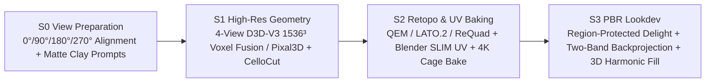

# QuadVox — Universal Multi-View 3D Production Pipeline via 4-View Lossless Sparse-Voxel Fusion

**English** | [简体中文](README.zh-CN.md) · [Architecture Spec (EN)](docs/ARCHITECTURE.md) | [架构设计规范 (中文)](docs/ARCHITECTURE.zh-CN.md)

A category-agnostic, modular multi-view 3D reconstruction, feature-preserving retopology, low-island SLIM UV baking, and Two-Band PBR lookdev pipeline centered on **Direct3D-V3 1536³ 4-View Lossless `8³` Sparse-Voxel Rotation Fusion**.

---

## Two-Layer Architecture: Universal Core (Layer 1) + Configurable Extensions (Layer 2)



| Architectural Layer | Core Technical Modules | Scope & Activation Policy |
|---|---|---|
| **Layer 1: 100% Universal Core** | • **Direct3D-V3 1536³ 4-View Lossless `8³` Sparse-Voxel Rotation Fusion**: step-level multi-view `x0` consensus fusion, orthographic Z-buffer occlusion culling, depth-discontinuity & overhang concavity suppression, timestep directional sharpening, and late CFG annealing<br>• **Pixal3D Multi-View + CelloCut (`QEF` Feature-Preserving Profiles)**: switches cleanly between sharp hard-surface feature preservation (`QEF=True`) and smooth organic reconstruction (`QEF=False`)<br>• **S2 Crease-Guided Blender 5.3 SLIM Low-Island UV + 4K Cycles Welded-Cage Baking + `LATO.2` Topological Repair**<br>• **S3 Region-Protected Delighting + `Two-Band` Frequency-Separated Multi-View Backprojection + Seam-Welded 3D Manifold Harmonic Inpainting + `Marigold-IID` PBR Derivation** | **Out-of-the-box for all categories**: works on arbitrary objects, hard-surface props, mechs, weapons, furniture, creatures, and characters given aligned `0°/90°/180°/270°` views and a coarse mesh. Its core mathematics relies solely on the exact discrete bijection of `8³` voxel grids under `90°` Y-axis rotations. |
| **Layer 2: Configurable Humanoid / Symmetric Switches (YAML)** | • **Front ROI View-Priority Lock (`front_roi_box` / `roi_boxes`)**: applies a C1-smooth 3D priority bounding box in S1 & S3 to lock high-saliency frontal regions (mech cockpits, chest crests, product logos, or humanoid faces) to a designated canonical view<br>• **OpenVDB Level-Set Spatial Coarse Mesh Splicing (`coarse_splice`)**: blends two complementary coarse meshes across height or spatial regions in the OpenVDB signed-distance domain<br>• **Optional `X=0` Mirror-Symmetric Retopology (`symmetry_x`)**: toggles bilateral `X=0` symmetry in `ReQuad` / `QuadriFlow` | **Strictly opt-in via YAML presets or CLI flags**: all Layer-2 switches default to `false` / `null` in `configs/engine_defaults.yaml` so asymmetric props and general objects are never distorted. |

---

## Technical Highlights

### 1. S1 Flagship: 4-View Direct3D-V3 1536³ Lossless `8³` Sparse-Voxel Fusion (`quadvox/s1_geometry/d3dv3_fusion.py`)
Direct3D-V3 operates on `8×8×8` sparse voxel blocks across hierarchical resolutions (`512³`, `1024³`, `1536³`). Under `90°` Y-axis rotations (`0° / 90° / 180° / 270°`, `det = +1`), sparse block coordinates and intra-block `8³` sub-voxel layouts map bijectively with **zero interpolation error** (verified via `<5ms` roundtrip self-check `max_abs_err == 0.0`):
- **Step-Level Multi-View `x0` Consensus Fusion**: rotates canonical sparse latents into all 4 orthographic camera frames at every denoising step, evaluates the velocity/denoiser network per view, rotates predictions back to canonical space, and blends them with occlusion-aware 3D weights.
- **Orthographic Occlusion Culling & Overhang Concavity Guard**: rasterizes hole-free `512×512` orthographic Z-buffers to cull self-occluded views, detects steep depth discontinuities (`cliff_keep`), and attenuates grazing side views inside downward overhangs (`crevice_keep`), falling back smoothly to C1 front/back weights.
- **Timestep Directional Sharpening & Late CFG Annealing**: ramps directional weight exponent `beta(t)` from `1.0` to `beta_max` (`3.5 / 4.5 / 5.5` across `512 / 1024 / 1536`) after `t >= 0.55`, and cosine-anneals CFG scale toward `3.5` after `t >= 0.72` to eliminate multi-view seam ridges and high-frequency ringing.
- **Stage-512 Multi-Seed Voxel Median Consensus**: computes the voxelwise median across seeds `(2025, 2026, 2027)` at the `512³` stage and prunes floating micro-shards before `1024³`/`1536³` upsampling.

### 2. Dual-Track S1 & S2 Geometry Pipeline
- **Hard-Surface Prop Track**: `Pixal3D MV + CelloCut (qef=True, res=1536, band=0.85, project_back=0.70)` → `LATO.2` low-poly retopology + `lato2_repair` (coplanar overlap removal, pinhole sealing, consistent outward winding) → crease-guided Blender SLIM low-island UV + 4K Cycles welded-cage bake.
- **Organic & Symmetric Asset Track**: `4-View Direct3D-V3 1536³` (with optional Layer-2 `coarse_splice` & `front_roi_box`) → topology-preserving QEM or `ReQuad` (with optional `symmetry_x: true`) → Blender SLIM low-island UV + 4K bake.

### 3. S3 Two-Band Backprojection & 3D Manifold Harmonic Inpainting (`quadvox/s3_lookdev/`)
- **Region-Protected Delighting**: removes baked specular highlights and shadows while constraining local exposure and chromaticity inside protected masks.
- **Two-Band Frequency-Separated Backprojection**: decomposes multi-view images into a low-frequency base band (`low_power=4.0` for seamless color transitions) and a high-frequency detail band (`detail_power=32.0` for crisp detail selection), preventing ghosting and blur.
- **Seam-Welded 3D Manifold Harmonic Inpainting**: solves a sparse Dirichlet Laplace equation directly over welded 3D surface topology to fill occluded blind spots without cross-UV-island color bleeding.
- **PBR Map Derivation**: derives metallic edge-wear (`curvature > 0.55`) and crevice grime (`ao < 0.45`) or integrates `Marigold-IID` maps into standard glTF 2.0 ORM textures and `.glb` outputs.

---

## Repository Structure

```text
├── .github/workflows/ci.yml         # Automated pytest & CLI verification workflow
├── configs/
│   ├── engine_defaults.yaml         # Layer-1 defaults & base profiles (object, hard_surface_prop, organic)
│   └── presets/
│       ├── symmetric_humanoid.yaml  # Layer-2 preset: symmetric humanoid (front_roi_box + coarse_splice + symmetry_x)
│       └── hard_surface_roi.yaml    # Layer-2 preset: hard-surface asset with front ROI priority lock
├── quadvox/
│   ├── contracts.py                 # Core data contracts: AssetProfile, ROISovereigntyBox, CoarseSpliceSpec, SemanticSchema
│   ├── cli.py                       # Unified CLI entrypoint (`quadvox`)
│   ├── cloud/colab_resilience.py    # Cloud GPU session manager: 80s/95s fast assign, orphan cleanup, SSH/rsync transfer
│   ├── tools/external_tools.py      # Portable binary resolvers (env vars / PATH, zero hardcoded machine paths)
│   ├── s0_views/                    # S0: view generation, matte clay prompts, RGBA alignment, ortho camera calibration
│   ├── s1_geometry/                 # S1: d3dv3_fusion.py, coarse_splice.py, Pixal3D adapters, CelloCut/inplace, SDF mesher
│   ├── s2_retopo/                   # S2: preclean, QEM, LATO.2 repair, ReQuad/QuadWild wrappers, SLIM UV + 4K cage bake
│   └── s3_lookdev/                  # S3: region-protected delight, Two-Band backprojection, 3D harmonic fill, PBR GLB export
├── runners/                         # Thin-client Colab GPU orchestrators & remote execution workers
├── scripts/install_external_tools.sh# Installation helper for external GPL-3.0 CLI tools (Blender / ReQuad / QuadWild)
├── docs/
│   ├── ARCHITECTURE.md              # Architecture & mathematical specification (English)
│   └── ARCHITECTURE.zh-CN.md        # Architecture & mathematical specification (Chinese)
└── tests/                           # Offline unit test suite (layer isolation, lossless voxel rotation, S0-S3 operators)
```

---

## Quickstart

### 1. Local Installation & Unit Tests
```bash
python3 -m venv .venv
source .venv/bin/activate
pip install -e ".[s2,dev]"
pytest -v
```

### 2. Inspect Profiles (Layer 1 vs Layer 2)
```bash
quadvox profile-show --profile object
quadvox profile-show --profile hard_surface_prop
quadvox profile-show --profile symmetric_humanoid
quadvox profile-show --profile hard_surface_roi
```

### 3. Run S0 / S1 / S2 / S3 Stages (Local or via Colab GPU)
```bash
# S0: Normalize 0°/90°/180°/270° RGBA inputs & generate orbit transforms.json
quadvox s0-preprocess --input path/to/views_raw --out-dir runs/my_asset/views_prepped --mode mv

# S1 (Colab GPU): 4-View Direct3D-V3 1536^3 Voxel Fusion (verify bundle locally first with --dry-run)
# Add --compare-crevice-keep to output both post-fix and pre-fix crevice_keep surface/mesh diffs.
python3 runners/run_d3dv3_4view.py \
  --profile hard_surface_roi \
  --coarse path/to/coarse.glb \
  --front views/front.png --left views/left.png --back views/back.png --right views/right.png \
  --out-dir runs/my_asset/s1_d3dv3 --compare-crevice-keep --dry-run

# S2: Blender SLIM Low-Island UV + 4K Normal/AO/Curvature Cycles Welded-Cage Bake
quadvox s2-unwrap-bake \
  --profile hard_surface_prop \
  --high-mesh runs/my_asset/s1_d3dv3/fused_1536.glb \
  --low-mesh runs/my_asset/s2/lowpoly.glb \
  --out-dir runs/my_asset/s2_bake

# S3: Two-Band Backprojection + Seam-Welded 3D Harmonic Inpainting + PBR Map Derivation
quadvox s3-lookdev \
  --profile hard_surface_prop \
  --mesh runs/my_asset/s2_bake/mesh_uv.glb \
  --front views/front.png --left views/left.png --back views/back.png --right views/right.png \
  --normal-4k runs/my_asset/s2_bake/normal_4k.png \
  --ao-4k runs/my_asset/s2_bake/ao_4k.png \
  --curvature-4k runs/my_asset/s2_bake/curvature_4k.png \
  --out-dir runs/my_asset/s3_lookdev
```

---

## 4-View Input Alignment Guidelines & Pitfalls

> **Core Rule**: The pipeline requires high-precision alignment of **geometric pose, orthographic camera elevation, and horizontal structural height lines**, while you do **NOT** need to manually pixel-tweak global scale or canvas centering (`quadvox/s0_views/` automatically computes and corrects bounding-box scale, 2D centering, and sub-pixel silhouette alignment).

### 1. Three Requirements That Must Be Strictly Aligned (Preventing P0 Geometric Artifacts)

1. **Key Structural / Anatomical Horizontal Height Lines & True Orthographic Angles (`0° / 90° / 180° / 270°`)**
   - The relative vertical height proportions of key horizontal landmarks (crown/top, eye line, chin, collar, chest line, hem, sole/base) must match across all four views, with zero camera pitch/elevation discrepancy (e.g., never mix an eye-level front view with a slightly high-angle side view).
   - **Empirical Failure Modes**: Even a few pixels of vertical offset on a small protrusion or ornament (such as an `X`-shaped hairpin or badge) between front and side views causes `Direct3D-V3` to carve the feature twice at shifted heights (`XX` double-ghosting); misaligned front/back ribbons or thin attachments produce thin "propeller-blade" slice artifacts along view fusion planes.
2. **Rigid Pose & Appendage Angle Consistency**
   - T-Pose / A-Pose arm elevation, stance width, and cuff/extremity orientation must be identical across all 4 views (for instance, in the side view, a horizontal T-Pose arm must foreshorten directly toward the camera rather than dropping or swinging forward/backward). Otherwise, `Pixal3D MV` forms underarm webbing bridges to the torso and loses side-profile silhouette fidelity.
3. **Zero Cross-View Semantic Contradictions**
   - Front, side, and back views must not hallucinate conflicting parts (such as a back view inventing a ponytail or pack absent from the side view, or asymmetric motifs flipped inconsistently). Conflicting geometry across views causes `Direct3D-V3` to generate porous "sponge-bridge" voxel noise along multi-view transition zones.

### 2. What Does NOT Require Manual Pixel Alignment (Handled Automatically by Code)
- **Global Scale & Canvas Centering**: `quadvox s0-preprocess` automatically extracts clean foreground bounding boxes and normalizes scale/centering (`pad_factor=1.1`), while `calibrate_s0_ortho_camera` and `compute_silhouette_alignment_warp` automatically solve per-view orthographic scale, 2D translation, and silhouette boundary alignment.

---

## Verification & Cloud GPU Benchmark Status

- **Offline Unit & Architecture Hygiene (`pytest -v`)**: `24 passed` (`test_architecture_and_hygiene`, `test_d3dv3_4view_fusion`, `test_s2_retopo_and_uv`, `test_s0_and_s3_lookdev`, `test_cloud_resilience_and_runners`), verifying:
  - Fixed descending-edge `_sstep` overhang `crevice_keep` vs pre-fix `legacy_unfixed` behavior via `compare_crevice_keep_preflight`, restoring vertical side-view retention (`|vn_x| > 0.70`) while suppressing downward overhangs (`vn_y < -0.58`).
  - S2 outer `1-2 px` UV island border smoothing & clamp (`smooth_clamp_uv_island_border`) before EDT gutter dilation, eliminating border grazing spikes and enforcing unit-length normals while preserving `head_ring_dilation=16` and `pack_method="blender_concave"`.
  - S3 optional `face_labels`-isolated `mesh_harmonic_fill` & `bake_two_band_albedo`, preventing cross-region color bleed across shared semantic boundary vertices and falling back cleanly on empty-observed semantic classes (`face_labels=None` remains backward-compatible).
  - S1/S2 runner `--dry-run` / `--dry-run-bundle` CLI contracts (`run_d3dv3_4view.py`, `run_s2_prop.py`, `run_s2_uv_bake.py`) and zero hardcoded `/tmp` or Layer-3 token leakage.
- **Host Dry-Run Bundle Check (`runners/run_d3dv3_4view.py --profile symmetric_humanoid --compare-crevice-keep --dry-run`)**: Passed cleanly on 4-view orthographic PNGs + normalized `1.0`m coarse GLB (`7,904,004` bytes, `1` chunk).
- **High-SKU Colab Live Status (`A100,H100,G4`, no `L4` fallback)**: Live `run_d3dv3_4view.py` high-SKU execution was skipped in this verification cycle because pre-flight high-SKU allocation returned `HTTP 503 Service Unavailable` across all three candidate GPUs (`A100` `32.2s`, `H100` `32.3s`, `G4` `32.1s`), with remote session cleanup confirmed empty (`Active assignments: 0`).

---

## Licensing & Third-Party Boundaries

- All original code in this repository is licensed under the **MIT License** ([LICENSE](LICENSE)).
- **No third-party model weights, GPL-3.0 binaries, or proprietary test assets** are bundled in this repository.
- See [THIRD_PARTY_NOTICES.md](THIRD_PARTY_NOTICES.md) for upstream model license terms (including optional non-commercial dependencies such as `Hunyuan3D-2.1`, `PartField`, `DINOv3`, `Marigold-IID`, and `Qwen-Image-2.1` along with permissive commercial alternatives) and process-isolated GPL-3.0 CLI tools (`Blender`, `ComfyUI`, `ReQuad`, `QuadWild`).
