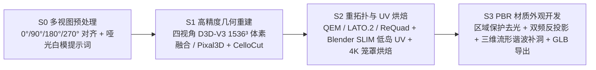

# QuadVox — 基于四视角无损体素旋转融合的通用多阶段 3D 生产管线

**简体中文** | [English](README.md) · [架构设计规范 (中文)](docs/ARCHITECTURE.zh-CN.md) | [Architecture Spec (EN)](docs/ARCHITECTURE.md)

一套与资产品类解耦的模块化多视图 3D 重建、特征保真重拓扑、低碎片化 SLIM UV 烘焙与双频段 PBR 材质生成（Lookdev）生产管线。核心围绕 **Direct3D-V3 1536³ 四视角无损 `8³` 稀疏体素旋转融合（Lossless Sparse-Voxel Rotation Fusion）** 构建。

---

## 分层架构设计：第一层（通用内核）+ 第二层（可配置扩展开关）



| 架构层级 | 包含的核心技术模块 | 普适边界与启用方式 |
|---|---|---|
| **第一层：100% 通用内核**<br>*(Universal Core)* | • **Direct3D-V3 1536³ 四视角无损 `8³` 稀疏体素旋转融合**：步级 `x0` 多视角协同去噪、正交深度缓冲（Z-Buffer）遮挡剔除、深度断层与悬垂内凹防重影抑制、跨时间步方向温度锐化与后期 CFG 余弦退火<br>• **Pixal3D 多视图重建 + CelloCut（`QEF` 特征保锐分档）**：按需切换硬表面锐边保持（`QEF=True`）与有机体平滑重构（`QEF=False`）<br>• **S2 折痕引导的 Blender 5.3 SLIM 低岛 UV + 4K Cycles 焊合笼罩（Welded Cage）烘焙 + `LATO.2` 拓扑修复**<br>• **S3 区域保护去光（Delighting）+ `Two-Band` 高低频分离多视角反投影 + 跨接缝三维流形谐波补洞 + `Marigold-IID` PBR 材质推导** | **全品类开箱即用**：只要输入正交对齐的 `0°/90°/180°/270°` 四视图与粗模，写实资产、硬表面道具、机甲、兵器、家具、生物或角色均可直接运行。核心数学仅依赖稀疏体素网格绕 Y 轴 `90°` 旋转的无损离散双射，与画风和品类无关。 |
| **第二层：人形/对称资产可配置能力**<br>*(Configurable Switches)* | • **正面 ROI 视角优先级锁定（`front_roi_box` / `roi_boxes`）**：在 S1 体素融合与 S3 纹理反投影中施加 C1 连续三维优先权包围盒，将机甲驾驶舱、胸甲浮雕、商品正面 Logo 或角色面部锁定至指定主视角（原称“ROI 视角主权锁”）<br>• **OpenVDB 水平集双粗模空间分区拼合（`coarse_splice`）**：将两套互补粗模按高度或空间区域在 Level-Set 域做 C1 平滑过渡融合<br>• **可选 `X=0` 镜像对称重拓扑（`symmetry_x`）**：控制 `ReQuad` / `QuadriFlow` 是否启用左右镜像对称约束 | **通过 YAML 配置档或 CLI 显式按需开启**：在 `configs/engine_defaults.yaml` 中默认全部关闭（`false` / `null`），确保非对称道具与任意通用物体不受对称或局部 ROI 假设干扰。 |

---

## 核心技术详解

### 1. S1 主力方案：Direct3D-V3 1536³ 四视角无损 `8³` 稀疏体素融合（`quadvox/s1_geometry/d3dv3_fusion.py`）
Direct3D-V3 在 `8×8×8` 稀疏体素块（分辨率依次为 `512³`、`1024³`、`1536³`）上执行扩散流匹配去噪。在绕 Y 轴的 `90°` 离散整数倍旋转（`0° / 90° / 180° / 270°`，行列式 `det = +1`）下，稀疏体素块坐标与块内 `8³` 子体素索引之间存在精确双射变换，**旋转与逆旋转重排具备零插值误差**（往返自检 `max_abs_err == 0.0`）：
- **步级 `x0` 多视角协同融合（Step-Level `x0` Consensus Fusion）**：在每个采样步将标准空间下的稀疏潜变量无损旋转至 4 个正交相机视角分别预测 `x0`，旋转回标准空间后按三维可见性权重加权融合。
- **正交遮挡剔除与悬垂内凹保护（Visibility & Concavity Guard）**：实时光栅化无孔洞 `512×512` 正交 Z-Buffer，剔除被自身几何遮挡的背面视角；同时检测陡峭深度断层（`cliff_keep`）与向下悬垂的内凹窄缝（`crevice_keep`），在侧视角掠射盲区平滑退回 C1 连续的前/后视角权重，消除多视角切面撕裂与双层重影。
- **时间步方向温度锐化与后期 CFG 余弦退火**：在去噪进程 `t >= 0.55` 后将四视角归一化权重的温度指数 `beta(t)` 从 `1.0` 平滑爬坡至 `beta_max`（`512/1024/1536` 阶段分别为 `3.5/4.5/5.5`），并在 `t >= 0.72` 后将 CFG 引导强度余弦退火至 `3.5`，抑制多视角接缝痕迹与高频振铃伪影。
- **Stage-512 多种子 SDF 体素中位数共识**：在 `512³` 粗采样阶段跨多个随机种子 `(2025, 2026, 2027)` 取逐体素 SDF 中位数并剔除孤立漂浮微碎片，为 `1024³` 与 `1536³` 稀疏上采样提供稳健基底。

### 2. S1 & S2 双轨几何与重拓扑管线
- **硬表面道具轨（Hard-Surface Props）**：`Pixal3D MV + CelloCut (qef=True, res=1536, band=0.85, project_back=0.70)` 保锐重构 → `LATO.2` 低模生成与 `lato2_repair`（共面重叠剔除、微孔封堵、法线朝向一致性修正）→ 折痕引导的 Blender SLIM 低岛 UV 展开 + 4K Cycles 焊合笼罩烘焙。
- **有机体 / 对称资产轨（Organic & Symmetric Assets）**：`4 视角 Direct3D-V3 1536³`（可按需启用 Layer-2 `coarse_splice` 与 `front_roi_box`）→ 保拓扑 QEM 减面或 `ReQuad` 四边面重拓扑（可按需开启 `symmetry_x: true`）→ Blender SLIM 低岛 UV + 4K 烘焙。

### 3. S3 双频反投影与三维流形谐波补洞（`quadvox/s3_lookdev/`）
- **区域保护去光（Region-Protected Delighting）**：对输入视图执行高光/阴影剥离，并在指定掩码区域内施加曝光与色度约束，防止局部色彩漂移。
- **高低频分离双频段反投影（Two-Band Multi-View Backprojection）**：将各视角纹理分解为低频基底（`low_power=4.0` 宽过渡融合）与高频细节（`detail_power=32.0` 锐利择优投影），兼顾跨视角色彩连续性与高频纹理清晰度。
- **跨接缝三维流形谐波补洞（Seam-Welded 3D Manifold Harmonic Inpainting）**：针对四视角均未覆盖的几何自遮挡盲区，在焊合后的三维网格表面直接构建并求解稀疏 Dirichlet Laplace 方程，从根本上杜绝传统 2D UV 图像补洞造成的跨 UV 岛串色。
- **物理材质贴图派生（PBR Map Derivation）**：支持基于烘焙曲率（`curvature > 0.55`）与环境光遮蔽（`ao < 0.45`）派生金属磨边与暗缝积灰，或结合 `Marigold-IID` 生成标准 glTF 2.0 ORM（Occlusion / Roughness / Metallic）贴图并导出 `.glb`。

---

## 仓库目录结构

```text
├── .github/workflows/ci.yml         # GitHub Actions 自动化测试与 CLI 校验流水线
├── configs/
│   ├── engine_defaults.yaml         # 第一层通用默认参数与基础配置档（object / hard_surface_prop / organic）
│   └── presets/
│       ├── symmetric_humanoid.yaml  # 第二层预设示例：对称人形资产（front_roi_box + coarse_splice + symmetry_x）
│       └── hard_surface_roi.yaml    # 第二层预设示例：带正面 ROI 锁定的硬表面资产（正面优先锁 + QEF + 金属 PBR）
├── quadvox/
│   ├── contracts.py                 # 核心数据契约：AssetProfile, ROISovereigntyBox, CoarseSpliceSpec, SemanticSchema
│   ├── cli.py                       # 统一命令行工具 (`quadvox`)
│   ├── cloud/colab_resilience.py    # 云端 GPU 会话管理：80s/95s 快速抢卡、孤儿会话回收、SSH/rsync 断点续传
│   ├── tools/external_tools.py      # 外部二进制工具定位器（基于环境变量与 PATH，零硬编码本机路径）
│   ├── s0_views/                    # S0：多视角生成、无材质哑光白模提示词、RGBA 对齐、正交相机标定
│   ├── s1_geometry/                 # S1：d3dv3_fusion.py, coarse_splice.py, Pixal3D 适配器, CelloCut/inplace, SDF 网格化
│   ├── s2_retopo/                   # S2：preclean, QEM, LATO.2 修复, ReQuad/QuadWild 封装, SLIM UV + 4K 笼罩烘焙
│   └── s3_lookdev/                  # S3：区域保护去光、双频反投影、三维流形谐波补洞、PBR GLB 导出
├── runners/                         # Colab GPU 瘦客户端编排脚本与远端执行 Worker
├── scripts/install_external_tools.sh# 外部 GPL-3.0 命令行工具（Blender / ReQuad / QuadWild）安装指引脚本
├── docs/
│   ├── ARCHITECTURE.md              # 架构与算法规范（英文）
│   └── ARCHITECTURE.zh-CN.md        # 架构与算法规范（中文）
└── tests/                           # 离线单元测试套件（架构隔离、体素旋转无损自检、S0-S3 核心算子）
```

---

## 快速上手

### 1. 本地环境安装与单测验证
```bash
python3 -m venv .venv
source .venv/bin/activate
pip install -e ".[s2,dev]"
pytest -v
```

### 2. 查看配置档（对比第一层默认档与第二层扩展档）
```bash
quadvox profile-show --profile object
quadvox profile-show --profile hard_surface_prop
quadvox profile-show --profile symmetric_humanoid
quadvox profile-show --profile hard_surface_roi
```

### 3. 按阶段运行 S0 / S1 / S2 / S3（本地或配合 Colab GPU）
```bash
# S0：标准化 0°/90°/180°/270° 四视角 RGBA 图像并生成轨道相机参数 transforms.json
quadvox s0-preprocess --input path/to/views_raw --out-dir runs/my_asset/views_prepped --mode mv

# S1（Colab GPU）：运行四视角 Direct3D-V3 1536^3 体素融合（可先加 --dry-run 本地校验打包内容与配置）
python3 runners/run_d3dv3_4view.py \
  --profile hard_surface_roi \
  --coarse path/to/coarse.glb \
  --front views/front.png --left views/left.png --back views/back.png --right views/right.png \
  --out-dir runs/my_asset/s1_d3dv3 --dry-run

# S2：Blender SLIM 低碎片化 UV 展开 + 4K 法线/AO/曲率 Cycles 笼罩烘焙
quadvox s2-unwrap-bake \
  --profile hard_surface_prop \
  --high-mesh runs/my_asset/s1_d3dv3/fused_1536.glb \
  --low-mesh runs/my_asset/s2/lowpoly.glb \
  --out-dir runs/my_asset/s2_bake

# S3：双频多视角反投影 + 三维流形谐波补洞 + PBR 材质贴图生成
quadvox s3-lookdev \
  --profile hard_surface_prop \
  --mesh runs/my_asset/s2_bake/mesh_uv.glb \
  --front views/front.png --left views/left.png --back views/back.png --right views/right.png \
  --normal-4k runs/my_asset/s2_bake/normal_4k.png \
  --ao-4k runs/my_asset/s2_bake/ao_4k.png \
  --curvature-4k runs/my_asset/s2_bake/curvature_4k.png \
  --out-dir runs/my_asset/s3_lookdev
```

---

## 开源许可与第三方组件边界

- 本仓库所有原创代码均基于 **MIT 许可证**发布（详见 [LICENSE](LICENSE)）。
- 仓库内**不包含任何第三方模型权重、GPL-3.0 二进制文件或专有测试美术资产**。
- 运行时按需加载的上游模型许可边界（含 `Hunyuan3D-2.1`、`PartField`、`DINOv3`、`Marigold-IID`、`Qwen-Image-2.1` 等带有非商用或区域附加条款的可选依赖及商用替代方案）与独立子进程调用的 GPL-3.0 工具（`Blender`、`ComfyUI`、`ReQuad`、`QuadWild`），请参见 [THIRD_PARTY_NOTICES.md](THIRD_PARTY_NOTICES.md)。
